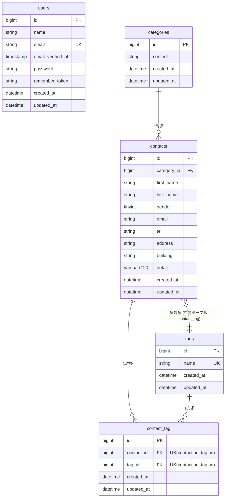

# COACHTECH お問い合わせフォーム (contact-form-app)

Laravel 10 および Docker (Laravel Sail) を用いて構築された、お問い合わせフォームおよび管理者用お問い合わせ・タグ管理システムです。

---

## 作成者
橋本 鈴子

---

## 概要

本システムは、一般ユーザーからのお問い合わせ受付機能と、管理者によるお問い合わせ内容の確認・検索・管理（CSV出力・API連携・タグ管理含む）を提供するWebアプリケーションです。

---

## 画面・機能・エンドポイント一覧

### 【一般ユーザー機能】
| メソッド | パス | 概要・機能 |
| :--- | :--- | :--- |
| GET | `/` | お問い合わせ入力画面（カテゴリ選択、タグ複数選択、リアルタイムバリデーションエラー表示） |
| POST | `/contacts/confirm` | お問い合わせ入力内容の確認処理・確認画面表示 |
| POST | `/contacts` | お問い合わせ送信処理 |
| GET | `/thanks` | お問い合わせ完了画面表示 |

### 【管理者機能 (認証: Laravel Fortify)】
| メソッド | パス | 概要・機能 |
| :--- | :--- | :--- |
| GET | `/register` | 管理者登録画面 |
| POST | `/register` | 管理者新規登録処理 |
| GET | `/login` | 管理者ログイン画面 |
| POST | `/login` | ログイン処理 |
| POST | `/logout` | ログアウト処理 |
| GET | `/admin` | 管理者用お問い合わせ一覧画面（7件ページネーション、検索・絞り込み表示） |
| GET | `/admin/contacts/{contact}` | お問い合わせ詳細表示 |
| DELETE | `/admin/contacts/{contact}` | お問い合わせ削除処理 |
| GET | `/contacts/export` | 検索条件に応じたお問い合わせデータのCSVエクスポート |
| POST | `/admin/tags` | 新規タグ追加処理 |
| GET | `/admin/tags/{tag}/edit` | タグ編集画面表示 |
| PUT | `/admin/tags/{tag}` | タグ更新処理 |
| DELETE | `/admin/tags/{tag}` | タグ削除処理 |

### 【API エンドポイント (公開API)】
| メソッド | パス | 概要 |
| :--- | :--- | :--- |
| GET | `/api/v1/contacts` | お問い合わせ一覧取得 (検索・ページネーション対応) |
| GET | `/api/v1/contacts/{id}` | 指定お問い合わせの詳細取得 |
| POST | `/api/v1/contacts` | お問い合わせの新規登録 |
| PUT | `/api/v1/contacts/{id}` | 指定お問い合わせの更新 |
| DELETE | `/api/v1/contacts/{id}` | 指定お問い合わせの削除 |

---

## 使用技術 (開発環境)

- **フレームワーク**: Laravel 10.x
- **認証**: Laravel Fortify
- **言語**: PHP 8.2
- **WEBサーバー**: Nginx
- **データベース**: MySQL 8.0 (`mysql/mysql-server:8.0`)
- **インフラ/環境**: Docker / Laravel Sail (`platform: linux/amd64`)
- **フロントエンド**: Vite / Tailwind CSS v3.4 / Blade
- **コード整形**: Laravel Pint
- **自動テスト**: PHPUnit / Laravel Testing

---

## ER図



---

## 環境構築手順

### 1. リポジトリのクローンと移動
```bash
git clone <repository-url>
cd contact-form-app
```

### 2. 環境変数ファイルの設定
```bash
cp .env.example .env
```

### 3. Composer パッケージのインストール（vendor 未導入時の初回実行）
```bash
docker run --rm -u "$(id -u):$(id -g)" -v "$(pwd):/var/www/html" -w /var/www/html laravelsail/php82-composer:latest composer install
```

### 4. Docker (Sail) コンテナの起動
```bash
./vendor/bin/sail up -d
```

### 5. アプリケーションキーの生成
```bash
sail artisan key:generate
```

フロントエンド資産をビルドする場合は、続けて以下を実行します。
```bash
sail npm install && sail npm run build
```

### 6. データベースマイグレーションと初期データ投入
```bash
sail artisan migrate --seed
```

---

## 開発環境 URL

- **一般お問い合わせフォーム**: http://localhost/
- **管理者登録画面**: http://localhost/register
- **ログイン画面**: http://localhost/login
- **管理画面**: http://localhost/admin

---

## テスト実行手順およびコードフォーマットチェック

### 全自動テスト実行コマンド
```bash
sail artisan test
```

### テストケース内訳 (全31件 PASS)
- **お問い合わせフォームテスト (ContactForm)**: 5件
- **認証機能テスト (Auth)**: 6件
- **管理画面テスト (Admin)**: 5件
- **タグ機能テスト (Tag)**: 3件
- **CSVエクスポート機能テスト**: 2件
- **API機能テスト (API)**: 6件
- **単体テスト (Unit)**: 4件

### コードフォーマットチェック（Laravel Pint）
```bash
sail bin pint --test
```