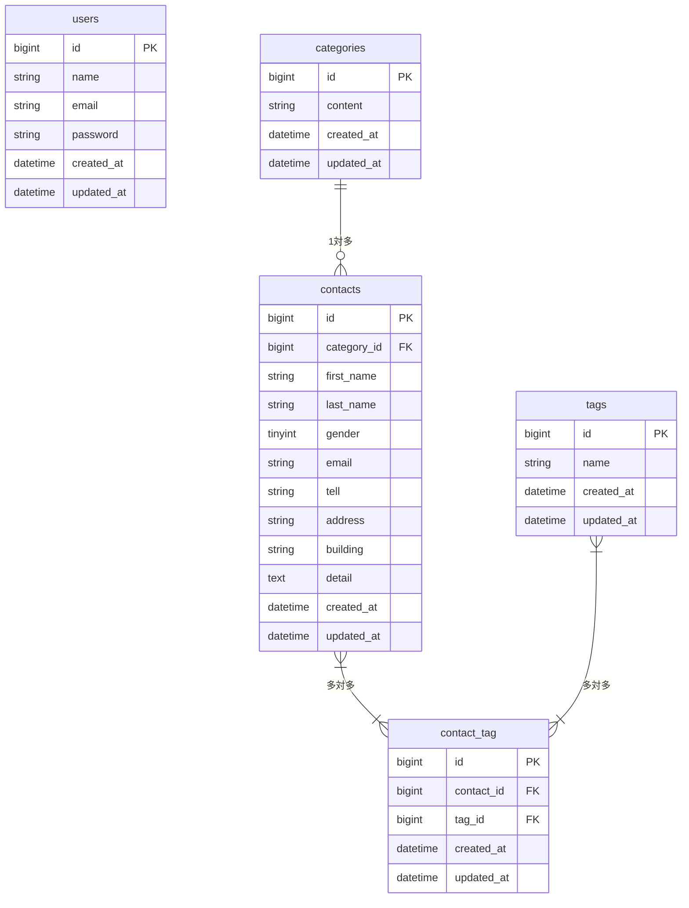

# COACHTECH お問い合わせフォーム (contact-form-app)

Laravel 10 および Docker (Laravel Sail) を用いて構築された、お問い合わせフォームおよび管理者用お問い合わせ・タグ管理システムです。

---

## 概要

本システムは、一般ユーザーからのお問い合わせ受付機能と、管理者によるお問い合わせ内容の確認・検索・管理（CSV出力・API連携・タグ管理含む）を提供するWebアプリケーションです。

---

## 機能一覧

### 【一般機能】
- **お問い合わせ入力画面 (`/`)**: カテゴリ選択、タグ選択（複数可）、バリデーションエラー日本語表示
- **入力確認画面 (`/contacts/confirm`)**: 入力内容の確認および修正機能
- **送信完了画面 (`/thanks`)**: 送信完了メッセージおよびTOPへ戻るリンク

### 【管理者機能 (認証: Laravel Fortify)】
- **管理者登録画面 (`/register`)**: 新規管理者アカウント作成
- **ログイン/ログアウト画面 (`/login`, `/logout`)**: 認証管理
- **お問い合わせ一覧画面 (`/admin`)**: 7件ごとのページネーション表示
- **検索・絞り込み機能**: お名前（部分一致）、メール、性別、カテゴリ、日付での多角検索およびリセット機能
- **詳細表示・削除**: お問い合わせ詳細情報の確認および削除機能
- **タグ管理機能**: タグの追加・編集 (`/admin/tags/{tag}/edit`)・削除機能 (CRUD)

### 【応用機能 (S評価要件対応)】
- **CSVエクスポート機能 (`/admin/contacts/export`)**: お問い合わせデータの一括CSVダウンロード
- **RESTful API**: お問い合わせデータの外部連携用公開API

---

## 使用技術 (開発環境)

- **フレームワーク**: Laravel 10.x
- **認証**: Laravel Fortify
- **言語**: PHP 8.2+
- **データベース**: MySQL 8.0
- **インフラ/環境**: Docker / Laravel Sail
- **フロントエンド**: Vite / Tailwind CSS / Blade
- **コード整形**: Laravel Pint
- **自動テスト**: PHPUnit / Laravel Testing (全31件 PASS)

---

## ER図



---

## API エンドポイント一覧

| メソッド | パス | 概要 |
| :--- | :--- | :--- |
| GET | /api/v1/contacts | お問い合わせ一覧取得 (検索・ページネーション対応) |
| GET | /api/v1/contacts/{id} | 指定お問い合わせの詳細取得 |
| POST | /api/v1/contacts | お問い合わせの新規登録 |
| PUT | /api/v1/contacts/{id} | 指定お問い合わせの更新 |
| DELETE | /api/v1/contacts/{id} | 指定お問い合わせの削除 |

---

## 環境構築手順

### 1. リポジトリのクローンと移動
```bash
git clone <repository-url>
cd contact-form-app
```

### 2. 環境変数ファイルの設定
```bash
cp .env.example .env
```

### 3. Docker (Sail) コンテナの起動
```bash
./vendor/bin/sail up -d
```

### 4. パッケージインストールとアプリケーションキーの生成
```bash
sail composer install
sail npm install && sail npm run build
sail artisan key:generate
```

### 5. データベースマイグレーションとシーディング
```bash
sail artisan migrate:fresh --seed
```

---

## 開発環境 URL

- **一般お問い合わせフォーム**: http://localhost/
- **管理者登録画面**: http://localhost/register
- **ログイン画面**: http://localhost/login
- **管理画面**: http://localhost/admin

---

## テスト実行手順

全自動テスト（31件）の実行コマンド：
```bash
sail artisan test
```

コードフォーマットチェック（Laravel Pint）：
```bash
sail bin pint --test
```
